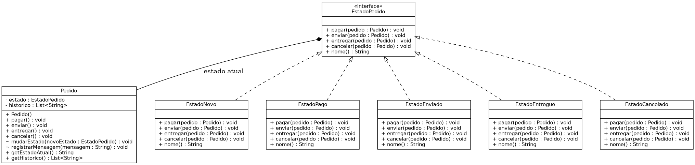

# Padrão de Projeto: State

Trabalho da disciplina Arquitetura e Projeto de Software — implementação do padrão de projeto comportamental State.

## O que o padrão resolve

O State permite que um objeto altere seu comportamento quando seu estado interno muda, como se ele trocasse de classe. Em vez de uma pilha de `if/else` ou `switch` checando o status atual toda vez que uma ação é chamada, cada estado vira uma classe própria que sabe exatamente o que fazer (e o que não é permitido) naquele momento.

## Aplicação escolhida

O ciclo de vida de um `Pedido`, que pode estar em cinco estados: **Novo**, **Pago**, **Enviado**, **Entregue** ou **Cancelado**. As ações possíveis sobre o pedido (`pagar`, `enviar`, `entregar`, `cancelar`) têm efeitos completamente diferentes dependendo do estado atual — por exemplo, `cancelar()` funciona normalmente em um pedido Novo ou Pago, mas é bloqueado em um pedido já Enviado ou Entregue. O `Pedido` não sabe essas regras; ele apenas delega a ação para o objeto de estado atual.

## Estrutura do projeto

```
state-pattern/
├── src/
│   ├── main/java/com/univassouras/state/
│   │   ├── EstadoPedido.java
│   │   ├── EstadoNovo.java
│   │   ├── EstadoPago.java
│   │   ├── EstadoEnviado.java
│   │   ├── EstadoEntregue.java
│   │   ├── EstadoCancelado.java
│   │   ├── Pedido.java
│   │   └── Main.java
│   └── test/java/com/univassouras/state/
│       └── PedidoTest.java
├── diagrama/
│   └── diagrama-classes-state.png
├── pom.xml
└── README.md
```

## Papéis do padrão nesta implementação

| Papel no padrão            | Classe neste projeto                                                                 |
|-----------------------------|------------------------------------------------------------------------------------------|
| Contexto                    | `Pedido`                                                                                  |
| Estado                       | `EstadoPedido`                                                                           |
| Estados concretos             | `EstadoNovo`, `EstadoPago`, `EstadoEnviado`, `EstadoEntregue`, `EstadoCancelado`          |

## Como executar

Pré-requisitos: JDK 17+ e Maven (ou usar o Maven embutido do IntelliJ).

```bash
mvn compile exec:java -Dexec.mainClass="com.univassouras.state.Main"
```

A saída mostra um pedido tentando ser enviado antes de ser pago (bloqueado), depois seguindo o fluxo correto até ser entregue, e por fim uma tentativa de cancelamento após a entrega (também bloqueada) — tudo isso sem nenhum `if` checando o status no código cliente.

## Como rodar os testes

```bash
mvn test
```

Os testes cobrem:
- o pedido começa no estado Novo;
- transições válidas (Novo → Pago → Enviado → Entregue);
- transições inválidas são bloqueadas e o estado não muda (ex.: enviar um pedido ainda não pago);
- cancelamento é permitido em Novo/Pago mas bloqueado em Enviado/Entregue.

## Diagrama de classes



## Autor

Trabalho individual — disciplina Arquitetura e Projeto de Software.
